# Comparatif Avant / Après — Lot 9 (Palette Plus Forte)

Ce document présente la comparaison visuelle systématique entre l'ancienne palette (Lot 6/7) et la nouvelle identité visuelle renforcée (Lot 9) pour les 8 vues clés de l'application SamaAdresse, aux résolutions 360×780 (mobile) et 1440×900 (desktop).

## Synthèse des Principes de la Palette Plus Forte

- **Fond de page :** Sable doré `#EADFC8` (remplace l'ancien fond blanc cassé).
- **Cartes & Conteneurs :** Crème `#FBF7EF` avec bordure `#766B5B` nette (remplace les ombres décoratives lourdes et le blanc pur).
- **En-tête :** Bleu nuit `#12304F` avec logo et typographies en crème `#FBF7EF`.
- **Bandeau d'accueil :** Bleu nuit `#12304F` avec bague crème `#FBF7EF` entourant la plaque pour détacher le bleu de l'enseigne.
- **Boutons principaux :** Ocre `#B84A24` avec texte blanc pur `#FFFFFF` sur fond clair ; jaune soleil `#F2B233` avec texte encre `#231A15` sur fond sombre.
- **Barre de navigation :** Fond crème `#FBF7EF`, bordure supérieure `#766B5B`, onglet actif bleu `#1D528F`.
- **Aucun blanc pur résiduel** dans l'interface, hors texte des boutons ocre et fond du QR code réglementaire.

---

### 1. Page d'accueil (Bandeau bleu nuit, bague crème, fond sable doré)

> **Évolutions visuelles :** En-tête bleu nuit #12304F, bague crème #FBF7EF autour de la plaque d'adresse, fond de page sable doré #EADFC8.

#### Vue Mobile (360×780)

| Avant (Lot 6/7) | Après (Lot 9 Palette Plus Forte) |
|:---:|:---:|
|  | 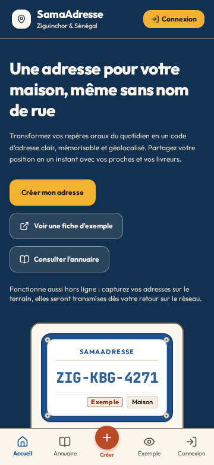 |

#### Vue Desktop (1440×900)

| Avant (Lot 6/7) | Après (Lot 9 Palette Plus Forte) |
|:---:|:---:|
|  | 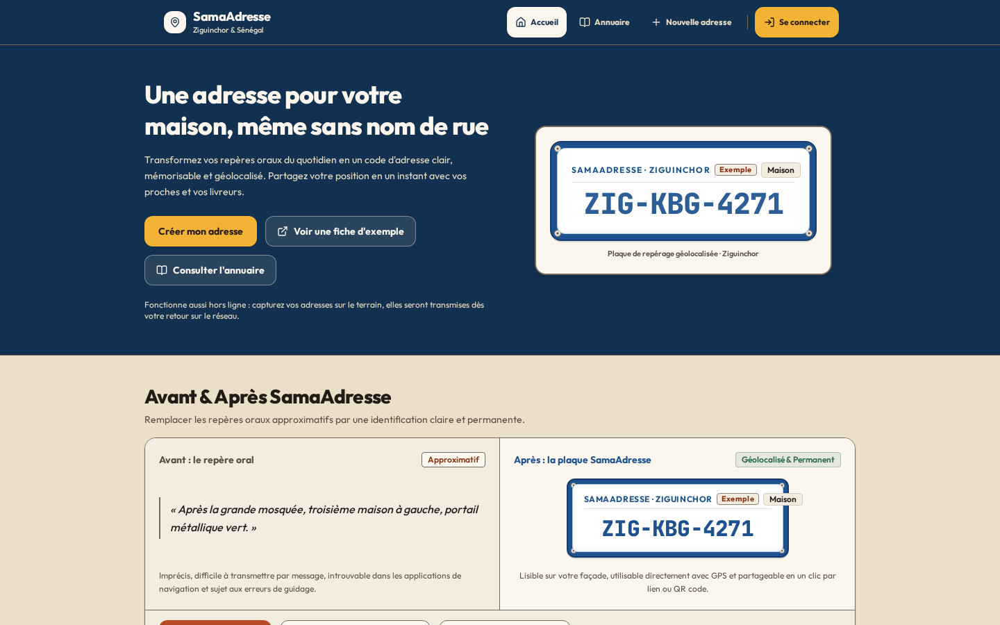 |

---

### 2. Connexion (Carte crème, bordure #766B5B, bouton ocre #B84A24)

> **Évolutions visuelles :** Formulaire sur carte crème #FBF7EF avec bordure #766B5B, bouton d'action en ocre #B84A24 avec texte blanc pur.

#### Vue Mobile (360×780)

| Avant (Lot 6/7) | Après (Lot 9 Palette Plus Forte) |
|:---:|:---:|
|  | 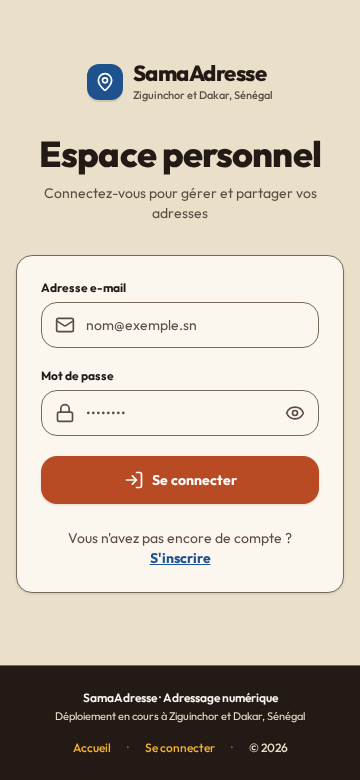 |

#### Vue Desktop (1440×900)

| Avant (Lot 6/7) | Après (Lot 9 Palette Plus Forte) |
|:---:|:---:|
|  | 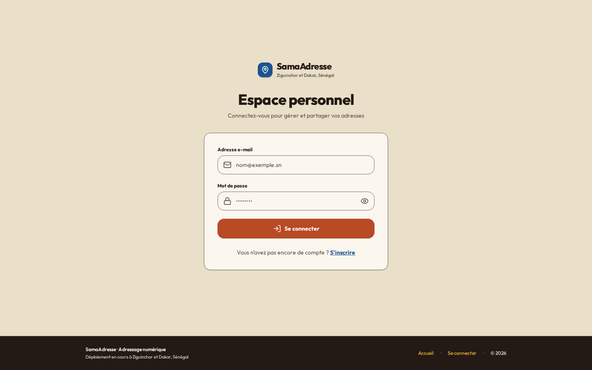 |

---

### 3. Mes Adresses (Cartes crème, statut bleu, navigation crème)

> **Évolutions visuelles :** Cartes des adresses sur fond crème #FBF7EF, barre de navigation basse en crème avec bordure supérieure #766B5B et onglet actif bleu #1D528F.

#### Vue Mobile (360×780)

| Avant (Lot 6/7) | Après (Lot 9 Palette Plus Forte) |
|:---:|:---:|
|  | 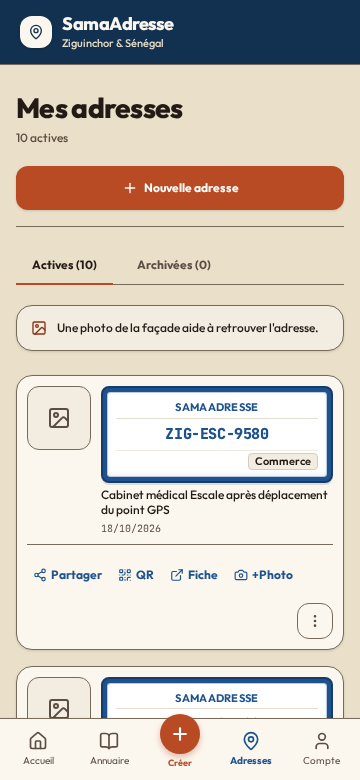 |

#### Vue Desktop (1440×900)

| Avant (Lot 6/7) | Après (Lot 9 Palette Plus Forte) |
|:---:|:---:|
|  | 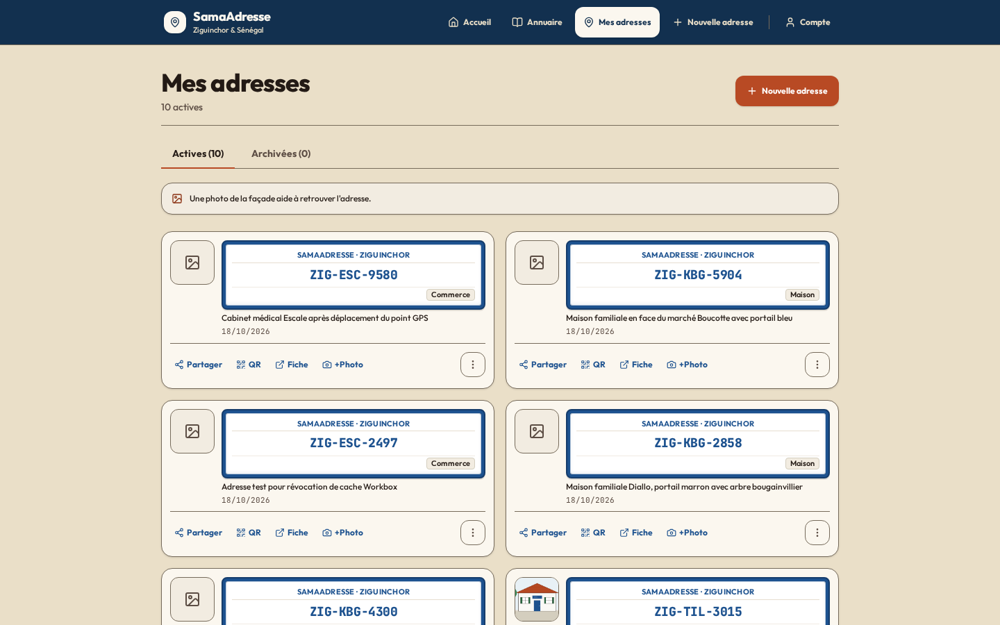 |

---

### 4. Fiche Publique (Plaque Terre & Enseigne inchangée, fond sable doré, sections crème)

> **Évolutions visuelles :** Plaque réglementaire bleue préservée à l'identique, sections d'informations en crème #FBF7EF sur sable doré #EADFC8.

#### Vue Mobile (360×780)

| Avant (Lot 6/7) | Après (Lot 9 Palette Plus Forte) |
|:---:|:---:|
|  | 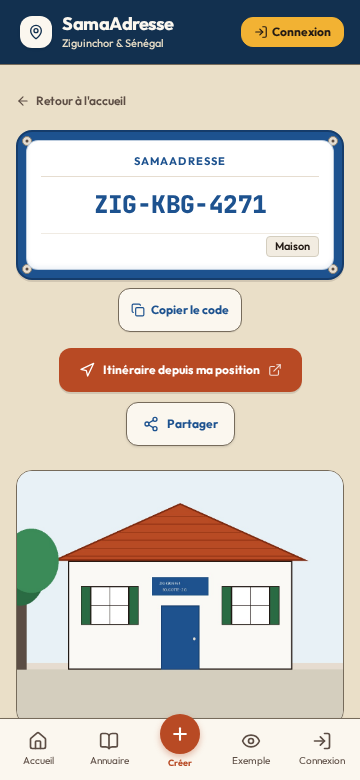 |

#### Vue Desktop (1440×900)

| Avant (Lot 6/7) | Après (Lot 9 Palette Plus Forte) |
|:---:|:---:|
|  | 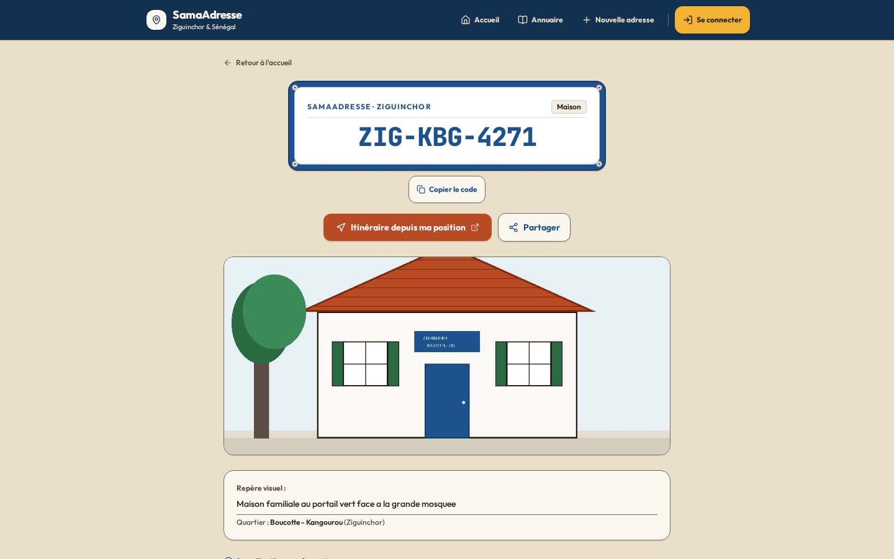 |

---

### 5. Annuaire Public (Barre de recherche sans double croix, filtres crème)

> **Évolutions visuelles :** Champs de filtres et résultats en crème #FBF7EF, suppression de l'icône native de réinitialisation WebKit sous WebKit/Blink.

#### Vue Mobile (360×780)

| Avant (Lot 6/7) | Après (Lot 9 Palette Plus Forte) |
|:---:|:---:|
|  | 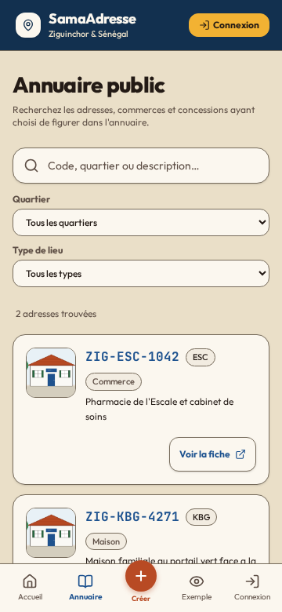 |

#### Vue Desktop (1440×900)

| Avant (Lot 6/7) | Après (Lot 9 Palette Plus Forte) |
|:---:|:---:|
|  | 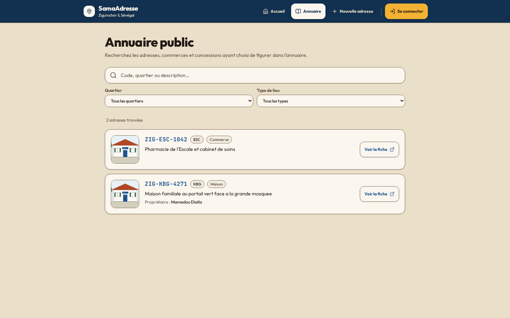 |

---

### 6. Assistant de création — Étape 2 Détails (Saisie sur carte crème)

> **Évolutions visuelles :** Étapes de création d'adresse avec contraste élevé sur fond crème #FBF7EF et bordures #766B5B.

#### Vue Mobile (360×780)

| Avant (Lot 6/7) | Après (Lot 9 Palette Plus Forte) |
|:---:|:---:|
| 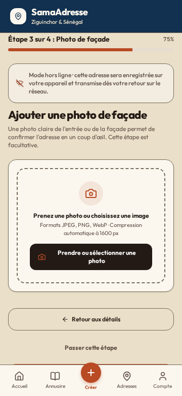 | 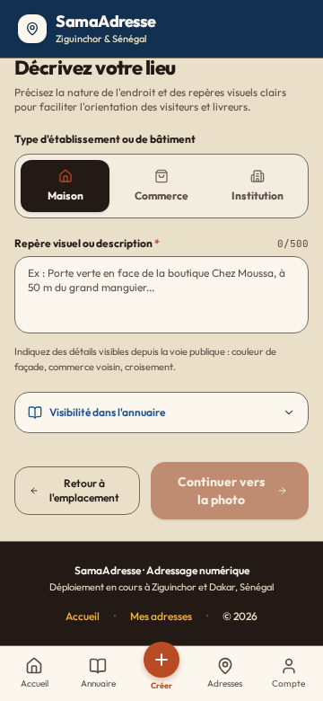 |

#### Vue Desktop (1440×900)

| Avant (Lot 6/7) | Après (Lot 9 Palette Plus Forte) |
|:---:|:---:|
| 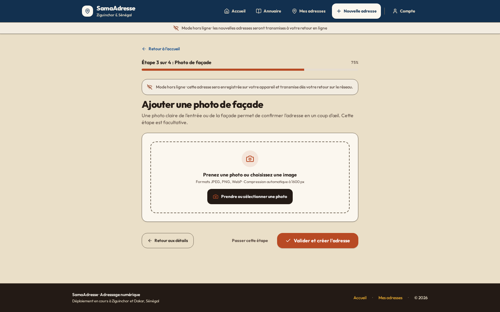 | 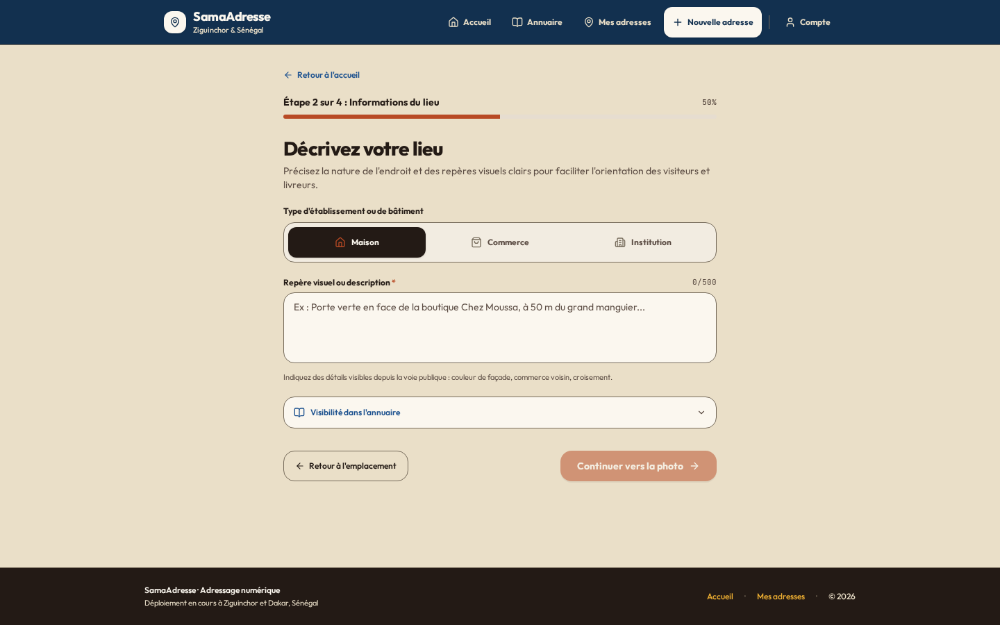 |

---

### 7. Plaque Hors Ligne (Mention « Enregistrée sur cet appareil »)

> **Évolutions visuelles :** Affichage immédiat (< 3 s) de la plaque avec code réservé ou provisoire, fond sable doré.

#### Vue Mobile (360×780)

| Avant (Lot 6/7) | Après (Lot 9 Palette Plus Forte) |
|:---:|:---:|
| 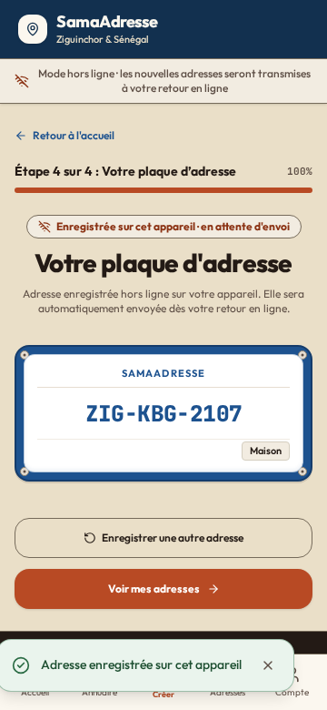 | 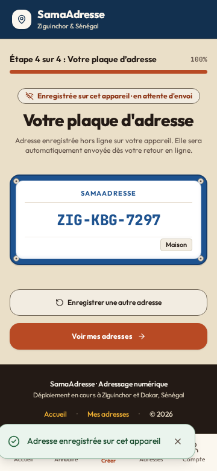 |

#### Vue Desktop (1440×900)

| Avant (Lot 6/7) | Après (Lot 9 Palette Plus Forte) |
|:---:|:---:|
| 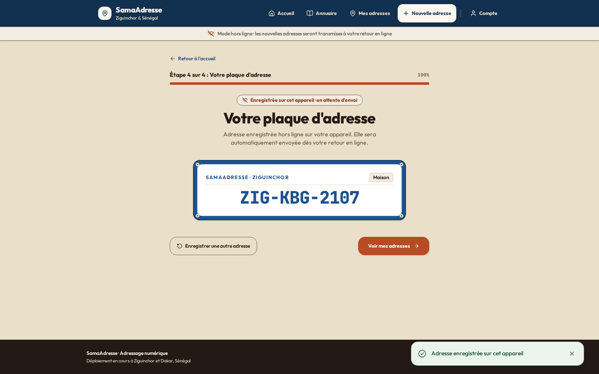 |  |

---

### 8. Modale d'avertissement de déconnexion (Alerte sur brouillons non synchronisés)

> **Évolutions visuelles :** Modale crème #FBF7EF avec fond de rideau assombri, boutons d'action conformes.

#### Vue Mobile (360×780)

| Avant (Lot 6/7) | Après (Lot 9 Palette Plus Forte) |
|:---:|:---:|
| 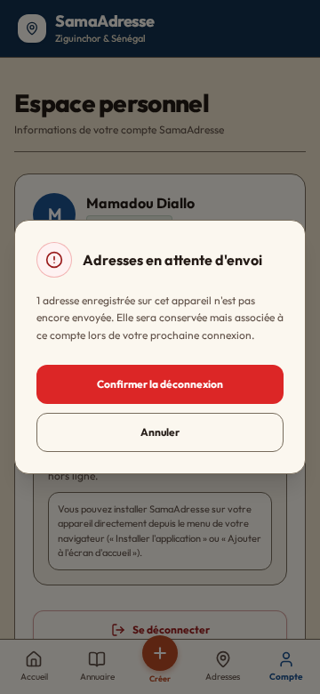 | 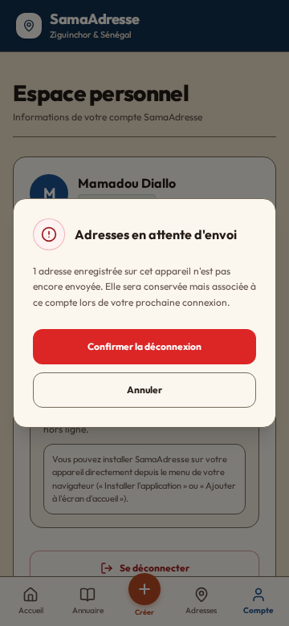 |

#### Vue Desktop (1440×900)

| Avant (Lot 6/7) | Après (Lot 9 Palette Plus Forte) |
|:---:|:---:|
| 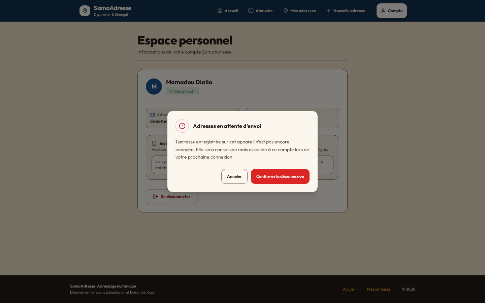 | 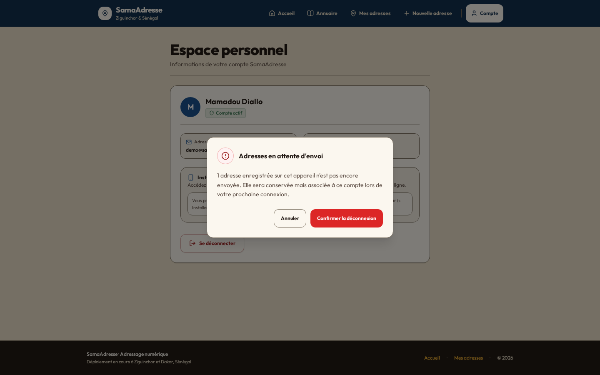 |

---
