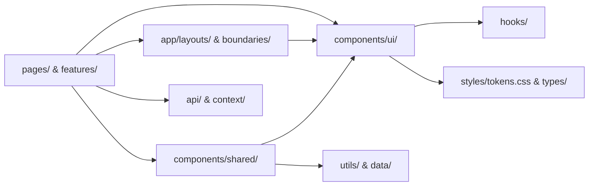

# P01 — Architecture Frontend Cible — SamaAdresse 2.0

**Mission :** P01 — Fondations Architecture, UX/UI & Design System  
**Branche :** `feature/p01-design-system` (issue de `feature/lot12-corrections` / `v1.1.0`)  
**Stack validée :** React 19.2.8 · TypeScript ~6.0.2 · Vite 8.3.0 · Tailwind CSS 4.3.3 · React Router 7.18.4 · Leaflet 1.9.4 · `vite-plugin-pwa` 1.3.0

---

## 1. Principes directeurs d'architecture

L'audit P00 a mis en évidence une base technique solide (PWA Workbox, IndexedDB, synchronisation hors ligne, JWT en mémoire, bundle ≤ 105 Ko gzip), mais limitée par des pages monolithiques (> 1 000 lignes), des couleurs hexadécimales codées en dur dans le JSX et une absence de primitives de formulaire atomiques.

SamaAdresse 2.0 adopte une architecture **modulaire orientée domaines (Feature-Driven)** et **stratifiée par responsabilités explicites**, conçue pour une migration progressive sans rupture de P01 à P04 :

1. **Séparation stricte présentation / logique métier / infrastructure** :
   - Les primitives UI (`src/components/ui/`) ne connaissent jamais l'API ni le routage métier complexe.
   - Les composants métier partagés (`src/components/shared/`) s'appuient sur les types réels d'`addressApi.ts` et `apiClient.ts` sans déclencher d'effets réseau cachés.
   - Les services API, IndexedDB et synchronisation (`src/api/`, `src/utils/offlineDb.ts`, `src/utils/syncManager.ts`) restent inchangés et garantissent 100 % de compatibilité backend et hors ligne.
2. **Zéro dépendance superflue** :
   - Aucun ajout de Redux, Zustand, TanStack Query, Storybook ou bibliothèque CSS tierce.
   - Utilitaires ciblés et légers (`src/utils/cn.ts`, `src/hooks/useFocusTrap.ts`, `src/hooks/useMediaQuery.ts`, `src/hooks/useClickOutside.ts`) préservant le budget strict du chunk d'entrée (≤ 105 Ko gzip).
3. **Coexistence maîtrisée (Strangler Pattern)** :
   - Les pages non encore refondues (réservées à P02, P03 et P04) continuent de fonctionner sans régression grâce à la conservation des alias de compatibilité Lot 9 dans `src/index.css` et à la rétrocompatibilité des interfaces des composants existants (`Card`, `Tabs`, `DataTable`, `SidePanel`, `ConfirmDialog`, `StatTile`, `StatusBadge`, `EmptyState`, `PageHeader`, `AddressPlate`, `Toast`).
4. **Résilience d'exécution** :
   - Une frontière d'erreurs globale (`src/app/boundaries/ErrorBoundary.tsx`) encapsule désormais l'arbre de routage dans `src/App.tsx`, éliminant le risque d'écran blanc en cas d'exception de rendu.

---

## 2. Organisation des dossiers (État P01 et Cible P02–P04)

```text
frontend/src/
├── app/
│   ├── boundaries/
│   │   └── ErrorBoundary.tsx      # [P01] Frontière d'erreurs React branchée dans App.tsx
│   └── layouts/
│       ├── AppShell.tsx           # [P01] Conteneur responsive (narrow/form/content/wide/max)
│       ├── PublicLayout.tsx       # [P01] Layout espace public (P02/P03)
│       ├── AuthenticatedLayout.tsx# [P01] Layout espace propriétaire (P03/P04)
│       ├── AdminLayout.tsx        # [P01] Layout espace modération admin (P04)
│       ├── AuthLayout.tsx         # [P01] Layout écran partagé connexion/inscription (P02)
│       └── index.ts
│
├── components/
│   ├── ui/                        # [P01] 24 primitives fondamentales + 6 structurants standardisés
│   │   ├── Button.tsx, IconButton.tsx, Input.tsx, Textarea.tsx, Select.tsx,
│   │   ├── Checkbox.tsx, RadioGroup.tsx, Switch.tsx, Badge.tsx, Avatar.tsx,
│   │   ├── Card.tsx, Divider.tsx, Skeleton.tsx, Spinner.tsx, Tooltip.tsx,
│   │   ├── Tabs.tsx, Breadcrumb.tsx, EmptyState.tsx, ErrorState.tsx, Alert.tsx,
│   │   ├── Toast.tsx, toastContext.ts, Modal.tsx, Drawer.tsx, DropdownMenu.tsx,
│   │   ├── StatTile.tsx, StatusBadge.tsx, DataTable.tsx, SidePanel.tsx,
│   │   ├── ConfirmDialog.tsx, PageHeader.tsx, index.ts
│   │   └── __tests__/components.test.tsx
│   ├── shared/                    # [P01] 11 composants métier réutilisables SamaAdresse
│   │   ├── AddressCard.tsx, AddressCode.tsx, AddressStatusBadge.tsx,
│   │   ├── LocationBadge.tsx, NeighborhoodTag.tsx, MapPreview.tsx,
│   │   ├── SearchBar.tsx, SearchFilter.tsx, UserProfileMenu.tsx,
│   │   ├── OfflineStatusIndicator.tsx, index.ts (+ réexport AddressPlate)
│   │   └── __tests__/shared.test.tsx
│   └── (existants préservés)      # AppNavigation, AppFooter, ConnectedLayout, AddressMap,
│                                  # AddressPlate, LeafletMapInner, ShareAddress, SmsShareForm...
│
├── features/                      # [Cible P02–P04] Modules métier découpés par domaine
│   ├── directory/                 # [P02] Recherche, filtres, grille cartes, vue carte/liste
│   ├── address-view/              # [P03] Fiche publique, galerie, itinéraire, partage, signalement
│   ├── address-wizard/            # [P03] Machine d'état et étapes de création (GPS/infos/photo/plaque)
│   ├── address-management/        # [P03/P04] Liste/grille propriétaire, édition, archivage
│   ├── dashboard/                 # [P04] Métriques propriétaire et tâches à traiter
│   ├── account/                   # [P04] Profil, cache hors ligne, codes réservés, préférences
│   └── admin-moderation/          # [P04] File de modération, tiroir d'instruction, audit
│
├── hooks/                         # [P01] Hooks transverses réutilisables
│   ├── useFocusTrap.ts            # Piège clavier WCAG + Échap + blocage scroll + restauration focus
│   ├── useClickOutside.ts         # Fermeture au clic extérieur (Dropdown, SearchBar)
│   ├── useMediaQuery.ts           # useSyncExternalStore aligné sur les 4 paliers responsive
│   └── index.ts
│
├── styles/                        # [P01] Source de vérité du Design System Clarté
│   ├── tokens.css                 # Tokens Tailwind v4 (@theme) + variables CSS + animations
│   ├── tokens.ts                  # Constantes typées TS alignées avec tokens.css
│   └── __tests__/tokens.test.ts   # Vérification automatisée WCAG 2.2 AA des contrastes
│
├── types/
│   └── designSystem.ts            # [P01] Types partagés (tailles, tons sémantiques, options)
│
├── api/                           # [INTACT] apiClient.ts, addressApi.ts
├── context/                       # [INTACT] AuthContext.tsx, OnlineStatusContext.tsx
├── data/                          # [INTACT] geo-grid.json
├── pages/                         # [P02–P04] Points d'entrée de routes (chargés en lazy)
└── utils/                         # [INTACT + cn.ts] offlineDb.ts, syncManager.ts, geoGrid.ts...
```

---

## 3. Responsabilités des couches et règles de dépendance



### Règles de dépendance strictes (à respecter en P02, P03 et P04)
1. **`styles/` et `types/`** ne dépendent d'aucune autre couche.
2. **`hooks/`** peut importer `styles/tokens.ts` ou `types/`, mais jamais `components/`, `api/` ou `pages/`.
3. **`components/ui/`** peut importer `utils/cn.ts`, `hooks/`, `types/`, `lucide-react` et `react-router-dom` (`Link`). **Interdiction** d'importer `api/`, `context/` ou `features/`.
4. **`components/shared/`** peut importer `components/ui/`, `utils/geoGrid.ts`, `utils/locationTypes.ts` et des **types uniquement** (`import type`) depuis `api/`. Les composants partagés restent pilotés par props pour être testables et réutilisables en contexte public, connecté ou hors ligne.
5. **`app/layouts/`** assemble la structure spatiale à partir de `components/ui/` sans embarquer de requêtes réseau.
6. **`pages/` et `features/`** orchestrent les appels `api/`, les contextes (`useAuth`, `useOnlineStatus`) et la synchronisation (`syncManager`, `offlineDb`), puis composent `app/layouts/`, `components/shared/` et `components/ui/`.

---

## 4. Conventions de développement

### TypeScript 6 strict (`tsconfig.app.json`)
- `verbatimModuleSyntax: true` : utiliser systématiquement `import type { ... }` pour les types.
- `erasableSyntaxOnly: true` : proscrire les `enum` TypeScript ; préférer les unions littérales (`export type ButtonVariant = ...`) et les objets `as const`.
- `noUnusedLocals` / `noUnusedParameters` : zéro variable ou paramètre mort.
- Toutes les interfaces de props sont nommées `<Composant>Props` et exportées.

### React 19 & Oxlint (compatibilité React Compiler / Fast Refresh)
- Ne jamais déclarer un composant React à l'intérieur d'un autre composant (`react/static-components`).
- Séparer les contextes/hooks des fichiers de composants (ex. `toastContext.ts` distinct de `Toast.tsx`) afin de préserver Fast Refresh (`react/only-export-components`).
- Privilégier `useSyncExternalStore` pour les abonnements navigateur (`matchMedia`, événements globaux) et éviter les `setState` synchrones dans `useEffect`.

### Performance & Code Splitting
- Ne jamais importer le barrel global `components/ui/index.ts` dans `App.tsx` ou les routes non lazy si seuls 1 ou 2 composants sont utilisés : importer directement le fichier cible (`components/ui/ErrorState`) pour maximiser le tree-shaking de Vite 8.
- Conserver Leaflet strictement isolé derrière `React.lazy(() => import('./LeafletMapInner'))`.
- Vérifier systématiquement `npm run check:size` après chaque lot : le chunk d'entrée `index-*.js` doit rester **≤ 105 Ko gzip**.

---

## 5. Stratégie de migration progressive (P01 → P04)

| Phase | Périmètre | Stratégie technique |
|---|---|---|
| **P01 (Actuelle)** | Tokens, Primitives UI, Composants métier, Layouts, ErrorBoundary, Docs | Coexistence douce ; les pages legacy restent intactes et fonctionnelles. |
| **P02** | Header unifié, Navigation, Homepage, Annuaire, Recherche, Filtres, Cartes, Vue carte/liste | Bascule du shell global (`App.tsx`) sur `bg-canvas` (`#FFFFFF`), adoption de `PublicLayout`, `SearchBar`, `SearchFilter`, `AddressCard`, `UserProfileMenu`. |
| **P03** | Fiche publique `/a/:code`, Assistant `/addresses/new`, Gestion `/addresses/mine` & Édition | Découpage en `features/address-view/`, `features/address-wizard/`, `features/address-management/`. |
| **P04** | Tableau de bord, Compte, Administration, Responsive final, Suppression legacy | Adoption de `AuthenticatedLayout` et `AdminLayout`, retrait de `ConnectedLayout` et des alias CSS Lot 9 dépréciés, alignement `scripts/check-contrast.py` et audit Lighthouse complet. |
