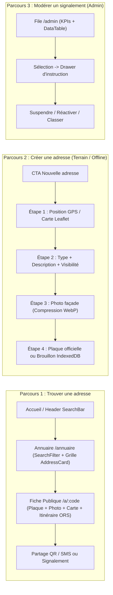

# P01 — Architecture UX/UI Globale et Règles Responsive — SamaAdresse 2.0

**Mission :** P01 — Fondations UX, Navigation, Parcours et Responsive  
**Référence ergonomique :** Clarté et recherche d'Airbnb · Cohérence de Stripe · Précision de Linear · Respect intégral du métier réel de SamaAdresse.

---

## 1. Cartographie des 4 espaces utilisateurs

SamaAdresse 2.0 sépare clairement quatre contextes d'usage afin de supprimer la confusion cognitive et la triple navigation observée dans l'audit P00 :

| Espace | Routes réelles | Utilisateurs cibles | Layout cible P01 | Intention UX principale |
|---|---|---|---|---|
| **1. Espace Public (Découverte)** | `/`, `/annuaire`, `/a/:code`, `/login`, `/register` | Visiteurs anonymes, livreurs, proches, citoyens | `PublicLayout`, `AuthLayout` | Rechercher une adresse, découvrir l'annuaire en cartes 4:3, consulter une fiche, calculer un itinéraire. |
| **2. Espace Utilisateur Connecté** | `/tableau-de-bord`, `/account` | Propriétaires connectés (`PROPRIETAIRE`, `ADMIN`) | `AuthenticatedLayout` | Piloter ses indicateurs réels, suivre la synchronisation hors ligne, gérer son compte et ses codes réservés. |
| **3. Espace Gestion d'Adresses** | `/addresses/mine`, `/addresses/new`, `/addresses/:id/edit` | Propriétaires créateurs / gestionnaires | `AuthenticatedLayout` | Créer une adresse sur le terrain (en ligne ou hors ligne), filtrer/modifier/archiver son patrimoine. |
| **4. Espace Administration** | `/admin` | Administrateurs (`ADMIN`) | `AdminLayout` | Instruire rapidement la file de signalements citoyens, suspendre/réactiver une adresse, suivre le journal d'audit. |

---

## 2. Architecture de navigation cible (pour implémentation P02)

### Résolution du problème critique P-03 (Triple navigation superposée)
Dans l'existant, un utilisateur connecté sur mobile subit simultanément :
1. Le header supérieur bleu (`AppNavigation`, 64 px).
2. La barre de sous-navigation `ConnectedLayout` (48 px).
3. La barre d'onglets basse fixe (`AppNavigation`, 56 px).

### Modèle unifié cible (Header contextuel unique)
- **Desktop (≥ 1024 px) — Un seul header sticky (`h-16` / `64 px`, fond blanc `#FFFFFF` avec bordure fine `border-border`) :**
  - **Gauche :** Logo SamaAdresse (lien `/`).
  - **Centre :**
    - Sur l'espace public / annuaire : `SearchBar` compacte cliquable (code, quartier ou repère).
    - Sur l'espace connecté : liens primaires sobres (`Annuaire`, `Tableau de bord`, `Mes adresses`).
  - **Droite :**
    - `OfflineStatusIndicator` compact (visible dès qu'hors ligne ou brouillons en attente).
    - Bouton primaire `Créer une adresse` (`/addresses/new`).
    - `UserProfileMenu` (pilule `Menu + Avatar` ouvrant `DropdownMenu` avec accès structuré : Tableau de bord, Mes adresses, Nouvelle adresse, Mon compte, Aide, Modération si `ADMIN`, Déconnexion).
- **Tablette (768–1023 px) :** Header unique allégé + `UserProfileMenu` ; les filtres secondaires passent en barre horizontale défilable (`SearchFilter`) ou tiroir (`Drawer`).
- **Mobile (320–767 px) :**
  - **Header haut compact (`h-14` / `56 px`) :** Logo à gauche, `OfflineStatusIndicator` compact + `UserProfileMenu` à droite. **Aucune sous-barre de navigation dupliquée.**
  - **Navigation basse épurée (`h-14` + `safe-area-inset-bottom`) :** 4 destinations clés maximum selon le contexte :
    - Public : `Accueil` · `Annuaire` · `Créer` · `Connexion`
    - Connecté : `Tableau` · `Adresses` · `+ Créer` · `Compte` (avec badge admin accessible dans `UserProfileMenu` ou onglet dédié).

---

## 3. Cartographie des parcours principaux

---

## 4. Spécification des 4 paliers Responsive Design

Le responsive n'est pas une simple réduction homothétique du bureau : chaque composant adapte sa densité et sa mécanique d'interaction.

| Composant / Zone | Smartphone (`320–767 px`) | Tablette (`768–1023 px`) | Desktop (`1024–1439 px`) | Grand écran (`1440 px+`) |
|---|---|---|---|---|
| **Conteneur max** | `100%`, `px-4` | `100%`, `px-6` | `max-w-[1280px]`, `px-8` | `max-w-[1440px]` (Admin & Split Map) |
| **Navigation** | Header 56 px + barre basse 4 items | Header 64 px + menu profil | Header unique 64 px + recherche centrale | Idem, espacements confortables |
| **Grille `AddressCard`** | 1 colonne (`grid-cols-1`, `gap-4`) | 2 colonnes (`grid-cols-2`, `gap-5`) | 3 colonnes (`grid-cols-3`, `gap-6`) | 4 colonnes (`grid-cols-4`, `gap-6`) ou Split Liste 2 col + Carte sticky |
| **`SearchBar`** | Pleine largeur, bouton loupe icône seule | Pleine largeur, bouton texte | Pilule centrée dans header ou héros (`max-w-2xl`) | Pilule `max-w-3xl` |
| **`SearchFilter`** | Défilement horizontal tactile (`sa-no-scrollbar`) | Défilement horizontal ou wrap | Ligne unique alignée + compteur | Ligne unique alignée |
| **Modales & Tiroirs** | `Drawer side="bottom"` (feuille mobile) ou `Modal` plein écran adapté | `Modal` centrée / `Drawer` droit | `Modal` centrée / `Drawer` droit (`max-w-lg`) | `Drawer size="lg"` (`max-w-2xl`) |
| **Tableaux (`DataTable`)** | Transformation automatique en cartes empilées lisibles | Table complète avec scroll horizontal sécurisé | Table complète aérée | Table complète + tiroir latéral |
| **Cartographie (`AddressMap` / `MapPreview`)** | Hauteur `256 px`, contrôle itinéraire pleine largeur | Hauteur `320 px` | Hauteur `360–420 px` ou volet sticky 50 % (P02) | Volet carte sticky 45–50 % |
| **Formulaires** | 1 colonne, boutons empilés pleine largeur (`min-h-[44px]`) | 1–2 colonnes (`max-w-[768px]`) | Split screen (`AuthLayout`) ou colonne centrée 768 px | Idem (jamais de lignes de saisie > 75 caractères) |

---

## 5. Principes d'interaction et micro-interactions

1. **Retour immédiat et non intrusif :**
   - Chaque action asynchrone bascule le `Button` en `isLoading` (conservation de largeur, zéro saut de mise en page).
   - Les confirmations légères utilisent `Toast` en bas à droite (au-dessus de la barre basse sur mobile grâce au calcul `safe-area-inset-bottom`).
   - Les actions destructrices ou structurantes (archivage, déconnexion avec brouillons en attente, suspension admin) passent systématiquement par `ConfirmDialog`.
2. **Transparence hors ligne :**
   - `OfflineStatusIndicator` rend visible l'état de connectivité et le nombre exact de brouillons IndexedDB sans bloquer la navigation.
   - `MapPreview` et `AddressMap` affichent un état de repli explicite (« Carte indisponible hors ligne ») en conservant l'affichage des coordonnées GPS locales.
3. **Accessibilité par défaut (WCAG 2.2 AA) :**
   - Navigation complète au clavier (`Tab`, flèches directionnelles dans `Tabs`, `RadioGroup`, `DropdownMenu`, `Escape` dans `Modal`, `Drawer`, `Tooltip`, `DropdownMenu`).
   - Restauration systématique du focus sur l'élément déclencheur à la fermeture des overlays (`useFocusTrap`).
   - Cibles tactiles ≥ 44 × 44 px sur les actions principales et mobiles.

---

## 6. Préparation des spécifications pour P02, P03 et P04

- **P02 (Espace Public & Découverte) :**
  - Remplacer `AppNavigation` par le header unifié Clarté et basculer `App.tsx` sur `bg-canvas` (`#FFFFFF`).
  - Refondre `HomePage` : héros lumineux avec `SearchBar` intégrée, démonstration `AddressPlate`, 3 étapes illustrées WebP conservées.
  - Refondre `DirectoryPage` : `SearchBar`, `SearchFilter` (quartiers + types), grille responsive d'`AddressCard` 4:3, et bascule Liste / Carte interactive Leaflet des résultats.
- **P03 (Cœur Métier Adresses) :**
  - Refondre `PublicAddressPage` (`/a/:code`) : galerie photo + plaque en en-tête, fiche deux colonnes (détails & carte à gauche, panneau sticky d'itinéraire ORS / partage QR & SMS / signalement à droite).
  - Découper et refondre `NewAddressPage`, `MyAddressesPage` et `EditAddressPage` avec les primitives de formulaire Clarté et en préservant 100 % du flux hors ligne IndexedDB.
- **P04 (Espaces Personnels, Admin & Certification) :**
  - Refondre `DashboardPage`, `AccountPage` et `AdminPage` avec `AuthenticatedLayout`, `AdminLayout`, `StatTile`, `DataTable` et `Drawer`.
  - Supprimer les reliquats CSS Lot 9, aligner `scripts/check-contrast.py`, et exécuter la certification complète (Playwright E2E + Lighthouse Docker + `check:size`).
